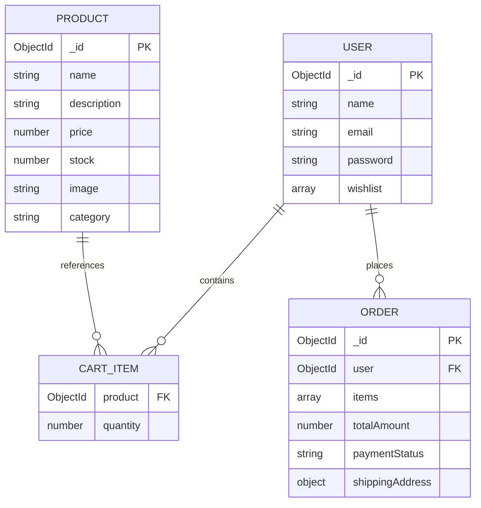

# 🛒 ShopKart — Full-Stack MERN E-Commerce & Shopping Cart System

[](https://react.dev/)
[](https://vitejs.dev/)
[](https://tailwindcss.com/)
[](https://nodejs.org/)
[](https://expressjs.com/)
[](https://www.mongodb.com/)
[](https://jwt.io/)
[](https://razorpay.com/)

> **ShopKart** is a production-grade full-stack MERN (MongoDB, Express, React, Node.js) e-commerce application featuring real-time client-side state synchronization, server-side data persistence, stock-validated cart operations, and end-to-end checkout.

---

## 📖 Table of Contents

- [Overview](#-overview)
- [Key Features](#-key-features)
- [System Architecture](#-system-architecture)
- [Data Models & Schema](#-data-models--schema)
- [API Endpoints Contract](#-api-endpoints-contract)
- [Frontend State Management](#-frontend-state-management)
- [Project Directory Structure](#-project-directory-structure)
- [Getting Started](#-getting-started)
  - [Prerequisites](#prerequisites)
  - [Backend Setup](#1-backend-setup)
  - [Frontend Setup](#2-frontend-setup)
- [Seeding & Testing](#-seeding--testing)
  - [Database Seeding](#database-seeding)
  - [API & Postman Test Suite](#api--postman-test-suite)
- [Important Business Rules & Edge Cases](#-important-business-rules--edge-cases)
- [Evaluation & Viva Reference Guide](#-evaluation--viva-reference-guide)

---

## 🌟 Overview

The core engineering objective of this system is resolving the challenge of **keeping client-side UI state, derived calculations, and persistent server-side MongoDB data completely in sync** across navigation and asynchronous network mutations.

```text
Browse Catalog ───► Add to Cart ───► Global State Sync (Navbar Badge & Cart)
                         │
                         ▼
             MongoDB Quantity Mutation (Stock Validated)
                         │
                         ▼
             Order Summary (Derived Totals) ───► Checkout Flow
```

---

## ✨ Key Features

- **Robust Cart Persistence**: Cart items are associated with authenticated user profiles in MongoDB using referenced `Product` ObjectIds and quantity counters.
- **Stock Limit Verification**: Prevents over-ordering beyond real-time inventory limits both during addition and quantity increment operations.
- **Single Source of Truth (Global State)**: Seamless synchronization between Product Cards, Navbar cart badges, and the dedicated Cart Page using React Context API.
- **Dynamic Derived Calculations**: Order subtotal, total items, and quantity counts are calculated purely on-the-fly from the cart state, avoiding stale data stored in the database.
- **Resilient UI States**: Interactive optimistic interactions with item-level loading indicators, comprehensive empty cart call-to-actions, and error handling.
- **Secure Authentication**: Protected API endpoints guarded by JSON Web Tokens (JWT) verified via Bearer token authorization or HTTP-only cookies.
- **Wishlist & Checkout Integration**: Native wishlist toggle functionality and complete checkout workflow integrated with Razorpay payment processing.

---

## 🏗️ System Architecture

```mermaid
flowchart TD
    subgraph Frontend["React 19 + Vite Frontend"]
        PC[Product Card]
        NB[Navbar (Cart Badge)]
        CP[Cart Page]
        CTX[CartContext State Provider]
        
        PC -->|dispatch addToCart| CTX
        CP -->|dispatch updateQty / remove| CTX
        CTX -->|derived cartCount| NB
        CTX -->|derived subtotal & items| CP
    end

    subgraph Backend["Express 5 + Node.js Backend"]
        AUTH[Auth Middleware (JWT)]
        CC[Cart Controller]
        OC[Order Controller]
        
        CTX <-->|REST API Requests| AUTH
        AUTH --> CC
        AUTH --> OC
    end

    subgraph Database["MongoDB Database"]
        USERS[(Users Collection: Cart Array)]
        PRODUCTS[(Products Collection: Stock & Price)]
        ORDERS[(Orders Collection)]
        
        CC <--> USERS
        CC <--> PRODUCTS
        OC <--> ORDERS
    end
```

---

## 🧩 Data Models & Schema

Cart data is stored directly within the authenticated `User` document as an array of referenced items:

```javascript
// models/User.js (Cart Schema extract)
cart: [
  {
    product: {
      type: mongoose.Schema.Types.ObjectId,
      ref: "Product",
      required: true
    },
    quantity: {
      type: Number,
      default: 1,
      min: [1, "Quantity cannot be less than 1"]
    }
  }
]
```

### Entity Relationship Diagram



> **Design Principle**: Product details (price, title, image) are **never duplicated** inside the cart array. When fetching the cart, `product` is populated from the `Products` collection, guaranteeing that users always see the latest pricing and stock availability.

---

## 🔌 API Endpoints Contract

### Cart Operations (Protected — Requires JWT)

| Method | Endpoint | Description | Status Codes |
|---|---|---|:---:|
| `POST` | `/cart/:productId` | Add product to cart or increment quantity by 1 | `200`, `400`, `401`, `404` |
| `GET` | `/cart` | Retrieve current user's cart populated with product details | `200`, `401` |
| `PATCH` | `/cart/:productId` | Update specific item quantity (`{ "quantity": number }`) | `200`, `400`, `401`, `404` |
| `DELETE` | `/cart/:productId` | Remove product entry completely from cart | `200`, `401`, `404` |

#### Sample Responses

<details>
<summary><b>GET /cart (Populated Response)</b></summary>

```json
{
  "success": true,
  "cart": [
    {
      "_id": "670c12e89ab12cd34ef5678a",
      "product": {
        "_id": "670c11f79ab12cd34ef56780",
        "name": "Mechanical Keyboard RGB",
        "price": 2999,
        "image": "https://images.unsplash.com/photo-1587829741301-dc798b83add3",
        "stock": 15,
        "category": "Electronics"
      },
      "quantity": 2
    }
  ]
}
```
</details>

<details>
<summary><b>PATCH /cart/:productId (Request Body)</b></summary>

```json
{
  "quantity": 3
}
```
</details>

### Additional Core APIs

- **Auth**: `POST /auth/register`, `POST /auth/login`, `GET /auth/me`, `POST /auth/logout`
- **Products**: `GET /products`, `GET /products/:id`
- **Wishlist**: `POST /wishlist/:productId`, `GET /wishlist`, `DELETE /wishlist/:productId`
- **Orders & Payments**: `POST /orders/create-order`, `POST /orders/verify-payment`, `GET /orders`

---

## 🌐 Frontend State Management

The application implements a centralized **CartContext** provider (`CartContext.jsx`) wrapped around the root route tree:

- **State Elements**: `cart` (array of populated items), `loading` (initial fetch & transition state), `error` (network or validation messages).
- **Cart Actions**:
  - `addToCart(productId)` — Performs API mutation and syncs state.
  - `updateQuantity(productId, newQty)` — Enforces optimistic validation & updates state.
  - `removeFromCart(productId)` — Removes item and updates state.
  - `fetchCart()` — Re-synchronizes client state directly from backend.
- **Derived State**:
  - `totalItems`: $\sum \text{item.quantity}$ (reflected in Navbar badge).
  - `subtotal`: $\sum (\text{item.product.price} \times \text{item.quantity})$.

---

## 📁 Project Directory Structure

```text
├── backend/
│   ├── config/             # Database connection & configurations
│   ├── controllers/        # Route controllers (cart, auth, product, order)
│   ├── middlewares/        # JWT auth verification middleware
│   ├── models/             # Mongoose schemas (User, Product, Order)
│   ├── routes/             # Express API routes
│   ├── utils/              # Helper utilities
│   ├── index.js            # Express server entrypoint
│   ├── seed.js             # Database catalog seeder script
│   ├── test-api.js         # API integration test runner
│   ├── test-lab6.js        # Checkout & order flow verification
│   ├── package.json
│   └── .env.example        # Environment variable template
│
├── frontend/
│   ├── public/             # Static public assets
│   ├── src/
│   │   ├── components/     # UI Components (Navbar, ProductCard, CartItem, etc.)
│   │   ├── context/        # React Context providers (AuthContext, CartContext)
│   │   ├── pages/          # Application views (Home, Products, Cart, Checkout, Orders)
│   │   ├── services/       # Axios API client instances
│   │   ├── App.jsx         # App router and layouts
│   │   ├── main.jsx        # React root DOM mount
│   │   └── index.css       # Global styles & Tailwind CSS imports
│   ├── index.html
│   ├── vite.config.js
│   └── package.json
│
├── lab5.md                 # Lab 05 engineering assignment specification
├── .gitignore              # Git ignore rules (node_modules, .env, dist)
└── README.md               # Main project documentation
```

---

## 🚀 Getting Started

### Prerequisites

- **Node.js** v18.0.0 or higher
- **npm** or **yarn**
- **MongoDB** instance (local daemon or MongoDB Atlas connection string)

---

### 1. Backend Setup

```bash
# Navigate to backend directory
cd backend

# Install dependencies
npm install

# Create environment file from template
cp .env.example .env
```

Configure your `.env` variables:

```env
PORT=5000
dburl=mongodb+srv://<username>:<password>@cluster0.mongodb.net/shopkart?retryWrites=true&w=majority
JWT_SECRET=your_jwt_secret_key
RAZORPAY_KEY_ID=your_key_id
RAZORPAY_KEY_SECRET=your_key_secret
```

Start the backend development server:

```bash
# Run with nodemon auto-reload
npm run dev

# Or start directly with node
npm start
```

The server will initialize on `http://localhost:5000`.

---

### 2. Frontend Setup

```bash
# In a separate terminal, navigate to frontend directory
cd frontend

# Install dependencies
npm install

# Start Vite development server
npm run dev
```

The frontend client will be available at `http://localhost:5173`.

---

## 🧪 Seeding & Testing

### Database Seeding

Populate the database with sample products and mock categories:

```bash
cd backend
node seed.js
```

### API & Postman Test Suite

Execute the automated backend test suite:

```bash
cd backend
npm test
# or
node test-lab6.js
```

#### Manual Postman Test Plan

1. **Test 1 — Add New Item**: `POST /cart/:productId` $\rightarrow$ Item added with quantity `1`.
2. **Test 2 — Duplicate Prevention**: `POST /cart/:productId` (again) $\rightarrow$ Quantity increments to `2` (no duplicate row).
3. **Test 3 — Fetch Cart**: `GET /cart` $\rightarrow$ Returns populated product details.
4. **Test 4 — Modify Quantity**: `PATCH /cart/:productId` with `{"quantity": 4}` $\rightarrow$ Returns updated cart.
5. **Test 5 — Stock Validation**: `PATCH /cart/:productId` with `{"quantity": 9999}` $\rightarrow$ Returns `400 Bad Request` (Stock limit exceeded).
6. **Test 6 — Remove Item**: `DELETE /cart/:productId` $\rightarrow$ Item removed from array.
7. **Test 7 — Security Check**: Send requests without JWT header $\rightarrow$ Returns `401 Unauthorized`.

---

## 🚨 Important Business Rules & Edge Cases

| Scenario | Handled Mechanism |
|---|---|
| **Same item added twice** | Increments existing item's `quantity` counter rather than creating duplicate row entries. |
| **Quantity exceeds inventory** | Rejected with `400 Bad Request: Requested quantity exceeds available stock`. |
| **Quantity reduced below 1** | Blocked in frontend controls and rejected by backend schema (`min: 1`). Removal requires explicit delete. |
| **Price / Stock volatility** | Product details are populated live at request time, ensuring fresh pricing and stock on every cart load. |
| **Page reload & sessions** | Cart state is persisted in MongoDB and fetched on app launch for the authenticated user session. |

---

## 🎤 Evaluation & Viva Reference Guide

<details>
<summary><b>1. Why does cart data need global application-level state?</b></summary>
Cart data is consumed concurrently by independent components in different branches of the component tree: the Navbar displays the cart badge, Product Cards show cart status, and the Cart Page manages order items. Centralizing this data in a single global context prevents prop-drilling, eliminates inconsistent local states, and avoids redundant network requests.
</details>

<details>
<summary><b>2. Why should subtotal and total items not be saved directly in MongoDB?</b></summary>
Subtotal and total quantities are <b>derived data</b>. Storing them in the database introduces denormalization anomalies: if a product's price updates or stock changes, saved totals would become stale or inconsistent. Calculating totals on-the-fly ($\sum \text{price} \times \text{quantity}$) ensures 100% accuracy at all times.
</details>

<details>
<summary><b>3. Why are full product objects not cloned inside the cart schema?</b></summary>
Storing only the `ObjectId` reference (`ref: 'Product'`) prevents data duplication and keeps the user document lightweight. Using Mongoose `.populate('cart.product')` retrieves the latest product details (updated title, images, prices, and stock) at read time.
</details>

<details>
<summary><b>4. How is race-condition stock validation enforced?</b></summary>
Before increasing an item's quantity or adding a new unit, the server queries the `Product` collection to verify that $\text{newQuantity} \le \text{product.stock}$. If insufficient units remain, the mutation is rejected before saving to the database.
</details>

---

<div align="center">

Built with ❤️ for **Engineering Lab 05 & 06 — ShopKart System**

</div>
